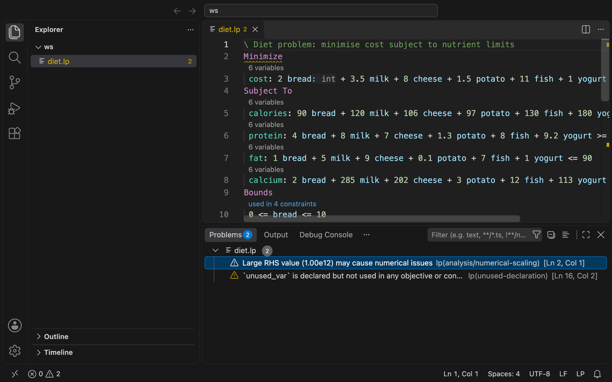

# LP Language Support

VS Code client for [`lp-lsp`](https://github.com/dandxy89/lp_parser_rs/tree/main/lsp), a language server for LP (linear programming) files in the CPLEX LP format with Gurobi extensions.



## Requirements

The Marketplace build bundles the server for your platform and needs nothing else. If you installed from a source build, install the server and put it on your `PATH` (or set `lp.server.path`):

```sh
cargo install --locked lp-lsp
```

Prebuilt binaries are on the [releases page](https://github.com/dandxy89/lp_parser_rs/releases).

## Features

- Syntax highlighting, comment toggling and bracket matching
- Diagnostics (syntax errors and model analysis), hover, completion, signature help
- Go to definition, declaration and type definition, references, highlights, rename, linked editing, call hierarchy, document and workspace symbols
- Formatting, folding, selection ranges, semantic tokens, inlay hints, code lenses and quick fixes
- Commands (palette category LP): *Analyse Model*, *Convert to MPS*, *Show Model Statistics*, *Restart Language Server*
- The "used in N constraints" code lens opens the references peek view

## Settings

| Setting | Default | Description |
| --- | --- | --- |
| `lp.server.path` | empty | Server binary; empty uses the bundled server, then `PATH` |
| `lp.trace.server` | `off` | Trace client/server messages |
| `lp.analysis.*` | | Toggle analysis diagnostics and their thresholds |
| `lp.semantic.maxFileSizeMb` / `debounceMs` | `20` / `300` | Full-parse scheduling |
| `lp.format.*` | | `indent`, `lineWidth`, `alignOperators`, `keywordCase` |
| `lp.inlayHints.*` | `true` | `generatedNames`, `rangePartners`, `variableTypes`, `normalisedRhs` |

## Development

```sh
npm ci
npm run compile   # or: npm run watch
npm run package   # produces lp-lsp-<version>.vsix
code --install-extension lp-lsp-*.vsix
```

## Other `.lp` extensions

`.lp` is also used for Answer Set Programming (clingo) files. If another extension claims it, pin the association:

```json
"files.associations": { "*.lp": "lp" }
```
