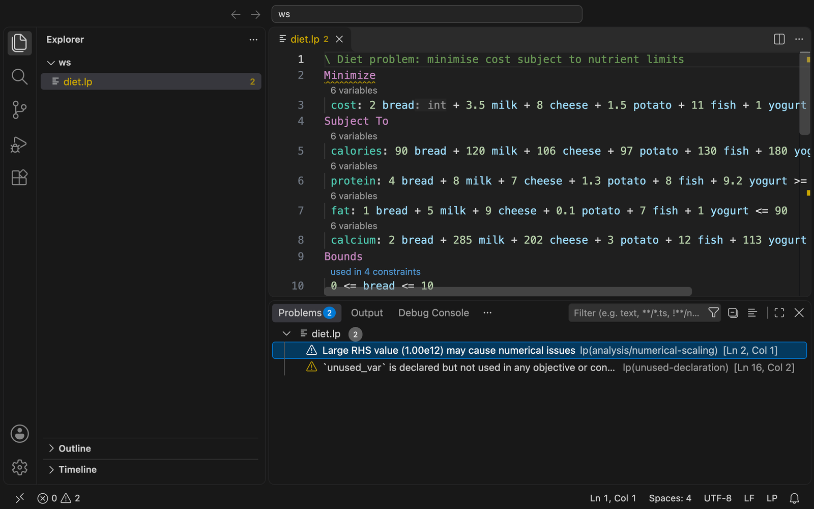

# LP & MPS Language Server

VS Code client for [`lp-lsp`](https://github.com/dandxy89/lp_parser_rs/tree/main/lsp), a language server for LP (linear programming) files in the CPLEX LP format with Gurobi extensions.



## Requirements

The Marketplace build bundles the server for your platform and needs nothing else. If you installed from a source build, install the server and put it on your `PATH` (or set `lp.server.path`):

```sh
cargo install --locked lp-lsp
```

Prebuilt binaries are on the [releases page](https://github.com/dandxy89/lp_parser_rs/releases).

## Features

- Syntax highlighting, comment toggling and bracket matching
- Diagnostics (syntax errors and model analysis), hover, completion, signature help
- Go to definition, declaration and type definition, references, highlights, rename, linked editing, call hierarchy, document and workspace symbols
- Formatting, folding, selection ranges, semantic tokens, inlay hints, code lenses and quick fixes
- Commands (palette category LP): *Analyse Model*, *Convert to MPS*, *Show Model Statistics*, *Restart Language Server*
- **LP activity bar view** (needs a server that advertises `lp/model`):
  - *Model Explorer*: objectives, constraints, variables grouped by type, and special rows (indicator, quadratic, SOS, lazy and user cuts), each with counts. Expand a constraint for its coefficients or a variable for the rows that use it; click any entry to jump to its source. The toolbar filters by name.
  - *Analysis*: model diagnostics grouped by category, then by code.
- The status bar shows model size (variables, constraints) and validity (no errors) for the active LP file.
- The "used in N constraints" code lens opens the references peek view
- *Solve* (on the objective) and *Explain* (on each named constraint) code lenses, switched by `lp.codeLens.actions`
- Model views, enabled when the server advertises the matching `lp/*` request (the webviews load no remote resources and run under a strict content security policy):
  - *Show Model Explorer*: objectives, constraints and variables in the Explorer sidebar; click to open the source
  - *Show Coefficient Matrix*: sparse matrix on a canvas, density overview for large models, click a cell to open the row (Shift-click for the column)
  - *Show Dependency Graph*: bipartite constraint/variable graph with search, component filter, neighbour highlighting and focus
  - *Compare Models*: mathematical diff against Git HEAD, the last saved file or another file; click a row to open it
  - *Solve Model* and *Diagnose Infeasibility*: results panel (status, objective, activities, slack, duals, binding) and an infeasibility tree; needs the `lp-highs` helper (`lp.solver.path`). Solution values also appear as hover text and inlay hints (`lp.solution.inlayHints`)
  - *Explain Constraint* / *Explain Variable*: terms, bounds, activity range, related rows and diagnostics (also in the editor context menu)

## Settings

| Setting | Default | Description |
| --- | --- | --- |
| `lp.server.path` | empty | Server binary; empty uses the bundled server, then `PATH` |
| `lp.trace.server` | `off` | Trace client/server messages |
| `lp.analysis.enabled` | `true` | Publish analysis diagnostics |
| `lp.analysis.heuristics` | `true` | Publish heuristic findings (smells that are sometimes intended); proven findings are unaffected |
| `lp.analysis.categories.*` | `true` | Switch `structural`, `numerical`, `mathematical` and `performance` findings on or off |
| `lp.analysis.severityOverrides` | `{}` | Per-code severity, for example `"large-coefficient": "hint"`; `off` hides a code |
| `lp.analysis.largeCoefficientThreshold` / `largeRhsThreshold` / `rhsCoefficientRatioThreshold` | `1e9` | Flag larger coefficients, right-hand sides, and right-hand sides larger than this multiple of their row's largest coefficient |
| `lp.analysis.smallCoefficientThreshold` | `1e-9` | Flag smaller non-zero coefficients |
| `lp.analysis.coefficientRatioThreshold` | `1e6` | Flag a larger max/min coefficient ratio |
| `lp.analysis.feasibilityTolerance` / `equalityTolerance` | `1e-6` / `1e-9` | Bound and row violations, and coefficient equality |
| `lp.analysis.maxPerCode` | `1000` | Diagnostics published per code before the rest are summarised |
| `lp.solver.path` | empty | Path of the `lp-highs` helper; empty searches next to the server, then `PATH` |
| `lp.solver.timeLimit` | `60` | Wall-clock limit for one solve, in seconds |
| `lp.solution.inlayHints` | `true` | Show solution values as inlay hints after a solve |
| `lp.solution.showStale` | `false` | Keep showing a solution after the document has changed |
| `lp.semantic.maxFileSizeMb` / `debounceMs` | `20` / `300` | Full-parse scheduling |
| `lp.format.*` | | `indent`, `lineWidth`, `alignOperators`, `keywordCase` |
| `lp.inlayHints.*` | `true` | `generatedNames`, `rangePartners`, `variableTypes`, `normalisedRhs` |
| `lp.codeLens.actions` | `true` | Solve and Explain code lenses |

The solve and infeasibility commands need the `lp-highs` helper. The Marketplace build bundles it for every
platform except Alpine. Otherwise install it with `cargo install --locked lp-highs` and put it on your `PATH`, or set `lp.solver.path`.

## Workspace trust

Restricted Mode runs only the language server and solver helper bundled with the extension. `lp.server.path`, `lp.solver.path` and `PATH` are ignored until the workspace is trusted, after which the server restarts. If the build has no bundled server, nothing starts and a warning offers *Manage Workspace Trust*.

## Development

```sh
npm ci
npm run compile   # type-checks, then bundles the extension and the webview scripts
npm test          # pure-module tests (node:test, no VS Code needed)
npm run package   # produces lp-lsp-<version>.vsix
code --install-extension lp-lsp-*.vsix
```

## Other `.lp` extensions

`.lp` is also used for Answer Set Programming (clingo) files. If another extension claims it, pin the association:

```json
"files.associations": { "*.lp": "lp" }
```
